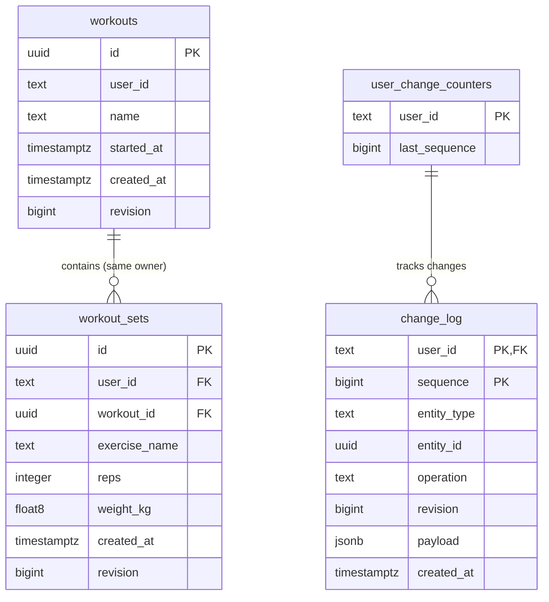

# Gym app stack with Vite+

## Summary

Build a phone-friendly website first, with permanent records stored in PostgreSQL on your computer or home server. Later, add an offline-capable Android app using SQLite and custom synchronization. AWS provides optional encrypted backups.

## Stack and development tooling

| Area | Choice |
|---|---|
| Website | React + TypeScript, CSS Modules |
| Web toolchain | [Vite+](https://viteplus.dev/guide/): Vite, Rolldown, Vitest, Oxlint, and Oxfmt |
| Web routing | TanStack Router |
| Web data fetching | TanStack Query with an in-memory cache |
| Backend | Go, standard-library `net/http`, and pgx |
| Server database | PostgreSQL on your own hardware |
| Authentication | Clerk with Google sign-in |
| Mobile app | React Native + Expo, Expo Router, and Metro |
| Mobile database | `expo-sqlite` |
| Charts | ECharts on web; Victory Native on mobile |
| Cloud backups | Private AWS S3 storage |

Use one repository with a pnpm workspace for web, mobile, and shared TypeScript packages. Keep the backend in its own Go module.

Use `vp dev`, `vp check`, `vp test`, and `vp build` for the website and shared TypeScript code. Enable type-aware linting and TypeScript checks. Use `vp run` to orchestrate Go, Expo, and other project tasks.

Expo retains its [Metro build pipeline](https://docs.expo.dev/guides/customizing-metro/). Mobile component tests use Jest, `jest-expo`, and React Native Testing Library; Go retains its native test tools.

## Application behavior and data flow

- **Planned features:** Workout logging, manual calories/macros, reusable meals, food search, barcode scanning, and progress dashboards. Deliver workout logging first, following the milestones below.
- **Workout logging:** Each workout contains exercise blocks with ordered sets. Record repetitions, weight in kilograms, and completion for each set, following the model below.
- **Web storage:** React calls the Go JSON API. PostgreSQL stores permanent fitness records; the browser holds temporary interface state.
- **Mobile storage:** Save immediately into SQLite. Existing local records remain usable when the home server or authentication services are unreachable.
- **Analytics:** Go queries PostgreSQL for web dashboards. Mobile calculates equivalent summaries from local SQLite. Share TypeScript models, validation, and pure calculations where applicable.
- **Custom synchronization:** Persist pending mobile operations, assign unique operation IDs, and acknowledge uploads so retries cannot duplicate records.
- **Change tracking:** All server writes feed a transactional, per-user change log. Download cursors and deletion records let mobile devices catch up after being offline.
- **Conflicts:** Check record revisions and preserve conflicting edits for explicit resolution.
- **Access control:** Go verifies Clerk tokens and enforces ownership for records, synchronization, and backups.
- **Import/export:** Provide versioned, per-user JSON archives.
- **Server recovery:** Schedule PostgreSQL backups, keep a copy away from the database host, and verify restoration into a separate database before relying on the app for daily records.
- **Cloud backups:** Encrypt archives on the client using AES-GCM and a separate recovery key before uploading through temporary S3 URLs. Keep recovery keys off the server.

## Current database structure

The diagram reflects migrations 1–3 in `services/api/migrations`. All columns are
required. `PK` means primary key; `FK` means foreign key. Exercise library and
exercise block tables belong to milestone 2 and are not yet implemented.

- One workout can contain zero or more sets; each set belongs to exactly one
  workout. The composite foreign key `(user_id, workout_id)` references
  `workouts(user_id, id)`, which has a composite unique constraint. This prevents
  a set from belonging to another user's workout.
- Each change-log entry belongs to one user counter. Its composite primary key is
  `(user_id, sequence)`, so different users can have the same sequence number.
- `change_log.entity_type` and `entity_id` identify the changed record in
  application code; they are not database foreign keys. There is no users table
  yet, and `workouts.user_id` has no foreign key to the counters table.
- `float8` is PostgreSQL's alias for `DOUBLE PRECISION`. Set lookup/order uses the
  index `(user_id, workout_id, created_at, id)`.

## Workout logging model

- **Exercise library:** Provide a chooser containing shared, read-only preset exercises and the user's private custom exercises. Users can create an exercise and reuse it in future workouts. Both kinds have stable exercise IDs; the API permits selection only of presets or custom exercises belonging to the current user. Introduce exercise identity and selection with blocks in milestone 2.
- **Exercise blocks:** Add an owner-scoped `workout_exercises` entity between workouts and sets. Each block has its own UUID, selected exercise ID, position, revision, and creation time. Exercise names live in the library; sets reference their block through an owner-scoped foreign key. Selecting a library exercise creates a new block. The same exercise may appear in multiple independent blocks within a workout; matching names or exercise IDs never automatically merge them.
- **Exercise names:** Display the current library name in every workout. Renaming a custom exercise updates its label in current and past workouts while keeping the same exercise ID, sets, and progress history. Store no separate name snapshot on blocks or sets. Use rename for corrections or relabeling the same exercise; create a new exercise for a different movement or variation. Presets remain read-only.
- **Ordering:** Exercise blocks can be reordered, carrying their sets with them. New blocks and sets append to the end of their respective lists. Sets cannot be moved within or between blocks; their stored positions stay fixed. Editing values or completion never changes order, including in old workouts. Deleting a set leaves a gap in stored positions; display set numbers as 1..n by sorted index. Use IDs as deterministic tie-breakers for equal positions.
- **Adding sets:** Prefill kg/reps from the preceding set in the same block, copying each field independently. With no preceding set, both fields start blank; copied blanks remain blank. The new set always starts unchecked, even if its source is completed. Copies remain independently editable.
- **Completion:** Unchecked sets may have blank or partially filled fields, represented by nullable kg/reps. Supplied values must be valid: positive integer reps and finite, nonnegative kg; `0 kg` differs from blank. Checking requires valid values in both fields; enforce this in the API and database. Filling fields does not automatically check a set. Unchecking preserves kg/reps.
- **Time:** Client-recorded `completed_at` stores the checkmark tap time; null means unchecked. Preserve it across ordinary value edits and retries, clear it when unchecking, and record a new tap time when checking again. Keep server `created_at` for ingestion time. History and charts use the parent workout's date (`started_at`), including when checking a set in an old workout. This replaces the planned per-set `performed_at` requirement for this scope.
- **Existing data:** Preserve the current set sequence (`created_at, id`) by migrating each contiguous run of exactly matching exercise names into a block. Do not merge nonadjacent occurrences or differently spelled names, or automatically assign presets based on names alone. Give legacy exercises stable user-owned IDs while preserving existing names and independent blocks. Original block boundaries cannot be recovered reliably from flat data; adjacent same-name blocks cannot be distinguished. Mark existing sets completed with `completed_at = created_at`, an approximate legacy completion time.
- **Exercise history:** Defer history, charts, and the "Previous" column to milestone 5, using the stable exercise IDs established in milestone 2. "Previous" will show values from a previous workout; prefilling from the preceding set in the current block belongs in milestone 2.
- **Deletion conflicts:** Reject block deletion if the block or any of its sets changed since the client last reviewed them, including added or removed sets and value/completion edits. Show the latest contents and require a fresh delete action after review; preserve pending local edits and never automatically retry deletion with a newer revision. Check for changes and remove the block/sets in one transaction.

Reorder blocks in one transaction using the complete, duplicate-free block-ID list and the workout's expected revision. Reject stale revisions or a list that does not exactly match the workout's current blocks. Adding, deleting, or reordering blocks must invalidate stale order revisions. Record the complete resulting order and affected revisions in one change-log event so future offline clients can reproduce the change. Specify the detailed workout/block revision changes and event payload before implementation.

The server assigns set positions when appending; create requests carry no position. Decide whether deleted positions may be reused before implementation: `max(position) + 1` reuses the last position after its set is deleted, while strict non-reuse requires a persistent counter. Surviving sets keep their stored positions in either case.

## Workout create retry contract

For valid create requests using the same user and client-supplied workout ID:

- **Same original create payload:** Return HTTP 200 with the current workout and
  its current revision, including any later edits. Keep its data, timestamps, and
  revision unchanged; create no additional workout or change-log event.
- **Different original create payload:** Return HTTP 409 Conflict with the generic
  error `Workout ID conflicts with this request`. Leave the existing workout
  unchanged and create no change-log event. Changing an existing workout requires
  a separate update request.

If the supplied ID belongs to another user, return the same HTTP 409 status and
generic error as a same-user payload mismatch. Return no workout or ownership
details, and change no workout data, revisions, or change-log events.

Allocate the per-user change sequence before entity lookups/writes as usual. A
retry or conflict must roll back that provisional allocation; only a new creation
commits the counter, workout, and create event together.

When `id` is omitted or null, keep the database-generated UUID fallback. Each
successful request creates a new workout and its create event; an identical retry
can therefore create a duplicate. Clients needing safe create retries must
generate an ID once and retain it across attempts. Do not deduplicate by workout
name or start time, since separate intentional workouts can share those values.

Clients retain the complete pending create body (`id`, `name`, and `started_at`)
across retries. Build it once for the initial submission, resend it after an
uncertain failure, and clear it after a successfully decoded HTTP 200/201 response.

Retry recognition after later edits must compare the request's `name` and
`started_at` with immutable original creation values for that user and workout ID.
Keep those original values available separately from the workout's current
editable values. A later rename must neither turn an original create retry into a
payload conflict nor be undone by that retry.

Compare names using exact string equality after the existing `strings.TrimSpace`
normalization. Surrounding whitespace does not cause a payload conflict; case and
internal whitespace remain significant.

Compare start times as instants with `time.Time.Equal`, so equivalent UTC offsets
match. Normalize incoming and retained original start times to UTC with fractional
seconds truncated to microsecond precision before storing or comparing them. This
matches the current pgx encoding and PostgreSQL's
[microsecond timestamp resolution](https://www.postgresql.org/docs/current/datatype-datetime.html).
Differences smaller than a microsecond within the same truncated value do not
cause a payload conflict.

Plan to retain original creation values in internal `original_name` and
`original_started_at` columns on the workout row. New creates write the normalized
original values in the same transaction as the workout and its event; later edits
leave them unchanged. This keeps retry recognition independent of future
change-log pruning.

For existing workouts, populate these columns from a trustworthy original workout
create event for the same owner and workout ID. The event payload contains the
initial `name` and `started_at`; the current row may contain later edits and must
not be used to guess the original values.

Verify that the event metadata and payload identify the same owner and workout,
and describe initial revision 1. Require exactly one workout create event for that
owner and workout ID; multiple create events leave the original values unverified.

Backfill candidates require a nonempty JSON-string name and a JSON-string start
time containing a fixed date/time with `Z` or an explicit numeric UTC offset and
at most six fractional-second digits, matching the stored creation payloads.
Validate timestamp parsing before casting. Exclude relative/special inputs such
as `now` or `infinity`, and timestamps whose offset would have to be guessed.

If original creation values cannot be recovered reliably, leave both original
columns null. Never infer them from the current workout values. A valid create
request reusing that workout ID returns the same generic HTTP 409 conflict without
changing data, revisions, or events, since a matching original payload cannot be
verified. Ordinary reads and edits of the existing workout remain available.

Use nullable `TEXT` and `TIMESTAMPTZ` columns for the original name and start time,
with a constraint requiring both values to be present or both null. New API
creates must always supply both original values.

## Delivery milestones

Work through each milestone as small learning exercises. Finish and verify the current exercise before starting the next architectural change.

1. **Finish editing a workout set.** Connect the existing edit form to the PUT helper, replace the saved row, and preserve drafts on failure. Add explicit stale-revision recovery that retains the draft while the user reloads the latest record. Verify persistence, failed saves, and stale edits before moving on.
2. **Establish exercise identity, blocks, and ordering.** Accept client-generated UUIDs for workouts, custom exercises, blocks, and sets; generate each ID once and retain it across create retries. Presets retain stable seeded IDs. Keep database-generated UUIDs as a fallback. A successful retry must not create another record or change-log event, and reusing an ID must never overwrite a record or disclose another user's data. Define how different create payloads using the same ID are rejected. Start with ID/retry handling, then introduce preset/custom exercise selection, custom exercise renaming, blocks, explicit block/set positions, and the migration above. Next add nullable fields, completion validation/checkmarks, and add-set prefilling; then implement block reordering. Preserve owner-scoped relationships and transactional change tracking throughout, including custom exercise changes.
3. **Complete workout logging.** Add set/block deletion and workout rename/delete. Deleting a block removes its sets in the same transaction and must reject changes the client has not reviewed, as described above. Record deletions transactionally so future offline clients can learn about every removed record, including blocks and sets removed with a workout. Define how deletion history is retained and how an old client recovers if its download cursor expires. Verify ownership and change-log behavior.
4. **Make workout logging ready for daily use.** Schedule database backups and demonstrate restoration into a separate database. Add Clerk authentication and verify account isolation. Choose and document remote access, TLS, and server configuration before exposing the app beyond local development. Authentication and tested recovery are prerequisites for deployment with real records.
5. **Add exercise history and workout dashboards.** Use the preset/custom exercise identities established in milestone 2 to add exercise history, the "Previous" column, and progress views. Keep repeated blocks independent when they link to the same exercise. Adopt TanStack Query as server-state handling grows and TanStack Router when adding screens. Extract Go packages when responsibilities become clear. Define analytics using shared inputs and expected outputs that both server and mobile implementations can test.
6. **Add nutrition in stages.** Start with manual calories/macros and reusable meals. Select a food data source after checking coverage and privacy requirements, then add search, barcode lookup, and caching for mobile offline use.
7. **Build Android storage, then synchronization.** Implement SQLite logging and a durable pending-operation queue before connecting sync. Add upload deduplication, download cursors, deletion handling, and revision checks. Preserve unsynced edits during conflicts; start with explicit reload/reapply choices before considering a richer resolution interface. Verify offline edits and interrupted retries against the existing server contracts.
8. **Add portable archives and optional cloud backups.** Implement versioned per-user export/import and restoration first. Specify the client responsible for encryption, recovery-key handling, and AES-GCM nonce management before adding encrypted S3 uploads. These archives complement the server recovery backups established earlier.

Weight representation remains unchanged during the edit exercise. Before dashboards and mobile calculations, decide the supported precision and representation across PostgreSQL, Go, TypeScript, and SQLite; changing only the PostgreSQL column does not settle calculation behavior.

## Validation, delivery, and defaults

- Verify preset/custom exercise selection and visibility, custom rename propagation to past workouts, stable exercise IDs, repeated exercise blocks, atomic block reorders, fixed set order after edits/deletions, completion validation, independent add-set copies, migration order/completion preservation, and rejection of stale block deletions.
- Test offline edits, interrupted synchronization, duplicate retries, conflicting edits, deletions, migrations, and account isolation.
- Test import/export round trips and backup restoration, including corrupted archives and incorrect recovery keys.
- Run `vp check`, `vp test`, `vp build`, Playwright browser tests, mobile component tests, and Go tests as appropriate.
- Benchmark with 50,000 workout sets and 50,000 food entries. Initial targets: mobile saves under 100 ms and standard charts under one second after data retrieval. Measure server queries and network latency separately.
- Deliver the website first, establishing IDs and change tracking from the beginning. Add Android and synchronization afterward; the Expo architecture supports iOS later.
- Keep AWS backups optional. The web app requires access to your home server.
- Treat Samsung health integration as a later feasibility project, retaining your requirement to avoid Samsung or Google health-data uploads.
